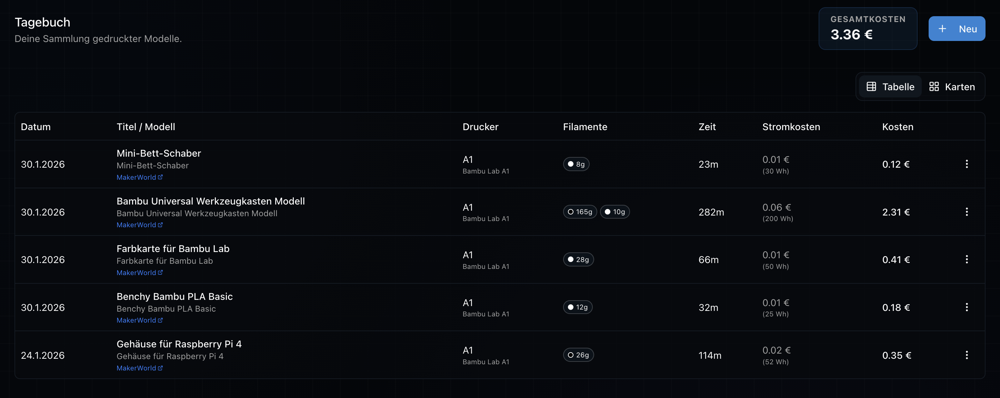
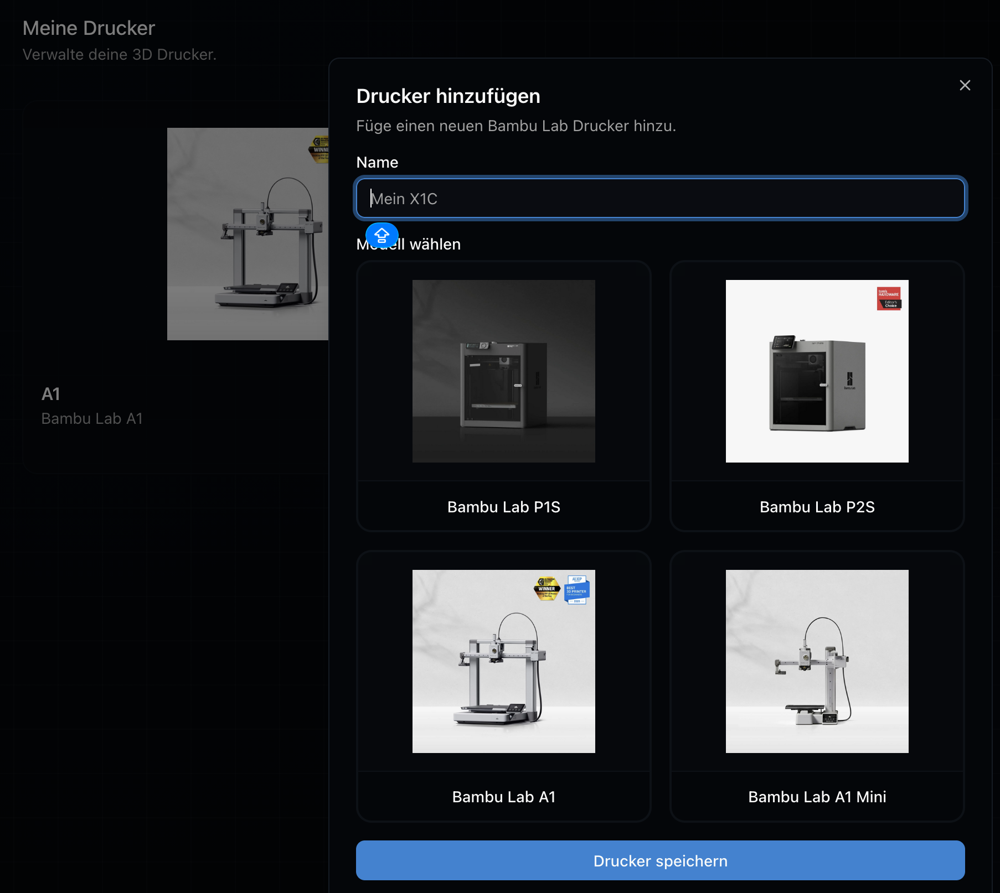

# 🖨️ 3D-Druck Tagebuch

Eine Web-App, mit der du deine 3D-Drucke dokumentierst, deinen Filament-Bestand verwaltest und den Überblick über Drucker, Kosten und Materialverbrauch behältst.

Statt Notizzettel und Excel-Tabellen: Ein MakerWorld-Link reicht, und die App holt sich Modellname, Bild, Druckzeit und Filamentbedarf automatisch.


---

## ✨ Funktionen

### 📒 Druck-Tagebuch
- Drucke erfassen mit Datum, Drucker, verwendeten Filamenten, Druckzeit und Notizen
- **MakerWorld-Import:** URL einfügen → Titel, Vorschaubild, Druckprofile, Druckzeit und Filamentgewichte pro Farbe werden automatisch übernommen
- Karten- und Tabellenansicht
- CSV-Export aller Drucke

### 🧵 Filament-Lager
- Filamente mit Hersteller, Material, Farbe (Color-Picker) und Restgewicht verwalten
- Das Restgewicht berechnet sich automatisch aus den eingetragenen Drucken

### 🖨️ Drucker
- Eigene Drucker anlegen und auswählen
- **Bambu Lab Live-Status** (optional): Verbindung per MQTT (IP, Access Code, Seriennummer) für Druckfortschritt, Restzeit und AMS-Belegung. Der Access Code wird verschlüsselt gespeichert.

### 🧮 Filament-Rechner
- Mehrere MakerWorld-Links einfügen und den gesamten Filamentbedarf inkl. Farbverteilung berechnen
- Öffentlich unter `/calculator` nutzbar, **auch ohne Login**
- Eingeloggt: Abgleich mit dem eigenen Lager und Berechnungen speichern

### 🤖 KI-Assistent
- Chat-Widget, das Fragen zu deinen eigenen Daten beantwortet („Wie viel PLA Schwarz habe ich noch?“, „Was hat mein letzter Druck gekostet?“)
- Basiert auf Google Gemini mit einer Wissensdatenbank aus deinen Druckern, Filamenten und Drucken (RAG mit Vektor-Embeddings) sowie live abgefragtem Lagerbestand

### ⚙️ Einstellungen
- Strompreis (ct/kWh) für die Kostenberechnung
- Wissensdatenbank für den KI-Assistenten aktualisieren
- Account löschen (außer beim Demo-Account)

---

## 🏗️ Aufbau

Das Repository besteht aus zwei Teilen:

```
3d-printing-diary/
├── frontend/   # Next.js-App (UI, API-Routen, Auth, Datenbank-Zugriff)
├── backend/    # Kleiner Express-Server zum Scrapen von MakerWorld mit Puppeteer
└── .github/    # GitHub Action: Deployment des Backends auf einen Raspberry Pi
```

| Teil | Technik | Hosting |
|------|---------|---------|
| **Frontend** | Next.js 16 (App Router), React 19, TypeScript, Tailwind CSS v4, Radix UI / shadcn, React Hook Form + Zod | Vercel |
| **Datenbank** | MongoDB (Collections u. a. `users`, `sessions`, `prints`, `filaments`, `printers`, `documents`) | MongoDB Atlas |
| **Auth** | Eigene Session-Auth (bcrypt + HTTP-Cookie) | – |
| **KI** | Google Gemini (`@google/genai`) für Chat und Embeddings | – |
| **Backend** | Node.js, Express 5, Puppeteer, Cheerio | Raspberry Pi (PM2 + ngrok), Deployment per GitHub Action |

**Warum ein separates Backend?** MakerWorld lässt sich nicht immer mit einfachem HTML-Parsing auslesen. Das Backend rendert die Seite mit einem echten Chromium (Puppeteer). Die Next.js-App ruft es über `NEXT_PUBLIC_BACKEND_URL` auf und nutzt zusätzlich einen eigenen Cheerio-Scraper unter `/api/scrape`.

---

## 🚀 Lokal starten

### Voraussetzungen
- Node.js 20+
- Yarn 4 (Frontend) bzw. npm (Backend)
- Eine MongoDB-Instanz (lokal oder Atlas)
- Optional: Google-AI-API-Key für den KI-Assistenten

### Frontend

```bash
cd frontend
yarn install
```

`frontend/.env.local` anlegen:

```env
MONGODB_URI_STRING=mongodb+srv://...
NEXTAUTH_SECRET=<zufälliger String, mind. 32 Zeichen – wird zum Verschlüsseln der Drucker-Access-Codes genutzt>
GOOGLE_AI_KEY=<Google AI API Key>          # optional, für den KI-Chat
NEXT_PUBLIC_BACKEND_URL=http://localhost:3001
NEXT_PUBLIC_BACKEND_TOKEN=<gleicher Wert wie BACKEND_TOKEN im Backend>
```

```bash
yarn dev
```

Die App läuft dann unter [http://localhost:3000](http://localhost:3000).

### Backend (optional, für den MakerWorld-Import per Puppeteer)

```bash
cd backend
npm install
```

`backend/.env` anlegen:

```env
BACKEND_TOKEN=<geheimer Token>
```

```bash
npm run dev
```

Der Server läuft auf Port `3001` und bietet den Endpunkt `POST /scrape` (Body: `{ "url": "<MakerWorld-URL>" }`, Header: `Authorization: Bearer <BACKEND_TOKEN>`).

---

## 📦 Deployment

- **Frontend:** Vercel (Konfiguration in `frontend/vercel.json`)
- **Backend:** Bei jedem Push auf `main`, der etwas in `backend/` ändert, deployt die GitHub Action [`.github/workflows/deploy.yml`](.github/workflows/deploy.yml) auf einen Self-Hosted Runner (Raspberry Pi) und startet den Prozess über PM2 neu. Der `BACKEND_TOKEN` kommt dabei aus den GitHub Secrets.

---

## 🛠️ Nützliche Befehle (Frontend)

| Befehl | Beschreibung |
|--------|--------------|
| `yarn dev` | Entwicklungsserver starten |
| `yarn build` | Produktions-Build erstellen |
| `yarn start` | Produktions-Build starten |
| `yarn lint` | ESLint ausführen |
| `yarn test` | TypeScript-Check + ESLint (läuft auch als Pre-Commit-Hook via Husky) |

---

## 📸 Screenshots

| Tabellenansicht | Filament-Lager | Druckerauswahl |
|---|---|---|
|  |  |  |
